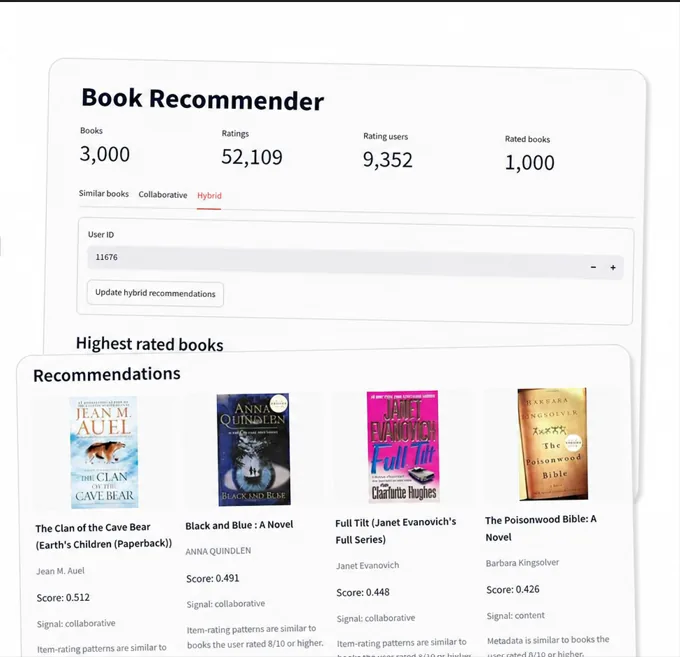

# Book Recommender

[](https://github.com/ridopandiSinaga/System-Recommendation/actions/workflows/ci.yml)

A book recommendation app with a hybrid of metadata similarity, item-based collaborative filtering, and popularity. Streamlit and FastAPI load the same verified model bundle. A separate experiment series tests whether neural models improve recommendations on Book-Crossing data.

[Live demo](https://books-system-recommendation.streamlit.app/) · [Case study PDF](docs/portfolio/book-recommender.pdf) · [Portfolio](https://ridopandisinaga.github.io/portfolio/#book-recommender) · [Experiment guide](docs/EXPERIMENTS.md)



## What the app does

- Find similar books from a title, using TF-IDF over titles, authors, and publishers.
- Recommend books for a known user from their rating history, with a score, source signal, and explanation.
- Return popular books when a user has no usable history.
- Reduce repeated editions using a normalized title-and-author key.

The shipped bundle contains **3,000 catalog books and 52,109 ratings from 9,352 users**, with ratings on 1,000 books. Its [manifest](models/hybrid.joblib.manifest.json) records the dataset fingerprint, training settings, dependencies, and SHA-256. The loader checks the checksum, runtime compatibility, and model structure before inference.

The base hybrid weights are 0.40 collaborative, 0.45 content, and 0.15 popularity; the model adjusts them when positive history is sparse. Rating 0 is excluded from explicit-feedback training. Duplicate user/ISBN ratings are averaged because the data has no timestamp for choosing the latest observation.

## What the experiments found

History-based cosine was the strongest of these three methods on both development splits. Neural softmax improved over popularity on one split, but the improvement did not repeat on the other.

| Method | Recall@10, split 17 (1,776 users) | Recall@10, split 29 (1,806 users) |
|---|---:|---:|
| Popularity | 4.22% | 3.65% |
| Neural history encoder, softmax | 6.14% | 3.65% |
| Cosine over positive reading history | **10.75%** | **10.96%** |

Each user has one held-out relevant work, so Recall@10 is the share whose target appears in the first ten recommendations. Percentages are rounded to two decimals. [Results and configuration](docs/evidence/neural_colab_history_results.json) · [Full analysis](notebooks/05_neural_history_experiments.ipynb)

**This is development evidence.** Assessment data was reused during development, the splits have overlapping users, and all evaluated users have a fit history. These results do not establish performance on a fresh test set or new users. The serving hybrid was not part of this comparison; the experimental cosine also differs from the app's adjusted-cosine component. No neural model has replaced the serving bundle.

A separate [catalog-size benchmark](docs/CATALOG_SIZE_BENCHMARK.md) retained the 1,000-interaction / 3,000-content configuration: larger catalogs improved reach, but neither challenger passed all selection gates.

## Run the app

Install [uv](https://docs.astral.sh/uv/), then run from a terminal:

```bash
git clone https://github.com/ridopandiSinaga/System-Recommendation.git
cd System-Recommendation
uv sync --python 3.12 --frozen --extra api
uv run --frozen streamlit run app/streamlit_app.py
```

The included bundle makes this path independent of Kaggle credentials, raw CSV files, and TensorFlow. **Use Python 3.12 for the shipped bundle**: its loader requires matching Python and dependency major/minor versions. Training a new bundle is a separate path.

To run the API instead:

```bash
uv run --frozen --extra api uvicorn app.api:app --host 127.0.0.1 --port 8000
```

Open `http://127.0.0.1:8000/docs` for interactive endpoints. `/readyz` reports the loaded artifact; `/healthz` reports process health. For example, `/v1/recommendations/users/11676?top_n=5` returns recommendations with their source and reason.

## Explore the evidence

| Start here | What it covers | Requirements to execute |
|---|---|---|
| [01 — End-to-end baseline](notebooks/01_end_to_end_book_recommender.ipynb) | Data preparation, hybrid, and catalog evaluation | Raw dataset for a full run |
| [03 — Experiment history](notebooks/03_neural_experiment_history.ipynb) | Decisions, candidates, and saved results across the neural studies | Development dependencies only |
| [04 — Ranking objectives](notebooks/04_neural_ranking_experiments.ipynb) | BPR, MSE, metadata, and ranking evaluation | Development dependencies only |
| [05 — Reading-history models](notebooks/05_neural_history_experiments.ipynb) | History encoders, cosine, and personalization checks | Development dependencies only |
| [02 — Neural training](notebooks/02_neural_book_recommender.ipynb) | Embeddings, forward pass, gradients, Adam, and training | Raw dataset and optional `neural` dependencies |

Notebooks 03–05 read the committed JSON evidence. Their tables and plots can be regenerated without a GPU, TensorFlow, raw data, or access to previous Colab sessions:

```bash
uv sync --python 3.12 --frozen --dev
uv run --frozen jupyter nbconvert --to notebook --execute notebooks/03_neural_experiment_history.ipynb --output-dir artifacts/experiment-history
```

Saved notebook outputs can also be read directly on GitHub. The [experiment guide](docs/EXPERIMENTS.md) separates fresh training from repeating the recorded runs, which require their original frozen inputs. The [configuration ledger](docs/portfolio/experiment-ledger.md) links each record to its evidence.

## Checks and project layout

```bash
uv sync --python 3.12 --frozen --dev --extra api
uv run --frozen --extra api ruff check src tests app scripts notebooks/*.py
uv run --frozen --extra api pytest
```

[CI](https://github.com/ridopandiSinaga/System-Recommendation/actions/workflows/ci.yml) checks the locked environment, lint, tests, the shipped bundle, notebook evidence, package builds, and the API container. The commands above run the base suite, with TensorFlow-specific tests skipped. The TensorFlow job runs the full suite with API dependencies and enforces 75% coverage.

Tests cover data contracts, artifact integrity, recommendation behavior, API failures, and Streamlit interactions. Synthetic notebook fixtures are for smoke tests, not reported model performance.

| Path | Purpose |
|---|---|
| [`src/book_recommender/`](src/book_recommender/) | Data preparation, models, evaluation, CLI, and shared serving service |
| [`app/`](app/) | Streamlit and FastAPI adapters |
| [`tests/`](tests/) | Model, data, artifact, API, UI, and notebook checks |
| [`scripts/`](scripts/) | Experiment workers and evidence audits |
| [`docs/evidence/`](docs/evidence/) | Saved metrics, run manifests, and diagnostic results |
| [`legacy/`](legacy/) | Earlier implementation, retained for reference |

## Limits and next steps

Title-and-author deduplication is a heuristic: subtitle variants can still appear as separate works. External cover URLs can fail even when recommendations load. The dataset has no interaction timestamps, so the reported splits cannot measure a chronological recommendation task. There are no online engagement or business-impact measurements.

Before an experimental model replaces the app's hybrid, compare both on the same new holdout using a protocol fixed in advance. Evaluate new-user behavior separately.

Data source: [Kaggle Book Recommendation Dataset / Book-Crossing](https://www.kaggle.com/datasets/arashnic/book-recommendation-dataset). Raw data and credentials are excluded from this repository. [Data preparation and reproduction](docs/EXPERIMENTS.md#prepare-data-for-a-new-run)
