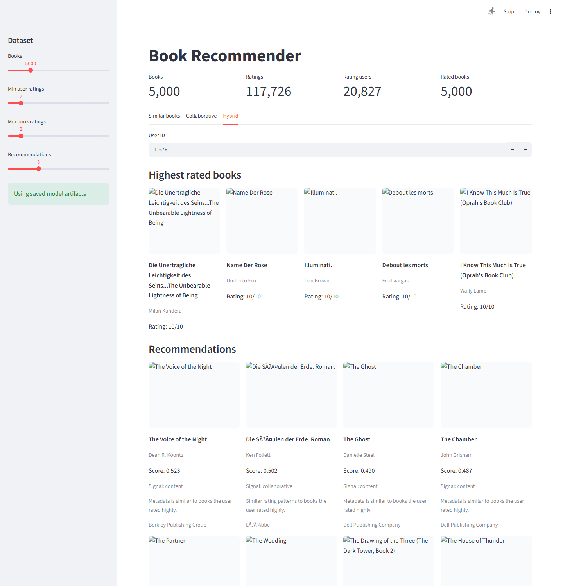

# Book Recommender System

Project ini membangun sistem rekomendasi buku yang bisa dijalankan ulang secara
lokal dan tersedia sebagai demo Streamlit. Fokus project:

- memproses Kaggle Book Recommendation Dataset dari file mentah
- membuat rekomendasi buku berbasis metadata buku
- membuat rekomendasi buku berbasis histori rating user
- menyediakan notebook end-to-end dan demo Streamlit

## Tech Stack

- Python 3.10 sampai 3.12
- uv untuk virtual environment dan dependency management
- pandas, numpy, scipy, scikit-learn
- Streamlit untuk demo app
- pytest dan ruff untuk verifikasi

## Struktur Project

```text
.
|-- app/
|   `-- streamlit_app.py
|-- data/
|   |-- raw/
|   `-- processed/
|-- docs/
|   |-- DATASET.md
|   `-- images/
|-- models/
|-- notebooks/
|   |-- 01_end_to_end_book_recommender.ipynb
|   `-- 01_end_to_end_book_recommender.py
|-- src/
|   `-- book_recommender/
|-- tests/
|-- pyproject.toml
`-- uv.lock
```

## Setup

Buat virtual environment dan install dependency:

```bash
uv venv .venv
uv sync --dev --extra app
```

Aktifkan environment di Windows PowerShell:

```powershell
.\.venv\Scripts\Activate.ps1
```

## Dataset

Dataset yang digunakan:

https://www.kaggle.com/datasets/arashnic/book-recommendation-dataset

File yang dibutuhkan:

- `Books.csv`
- `Ratings.csv`
- `Users.csv`

Letakkan ketiga file tersebut di `data/raw/`.

Download dengan Kaggle CLI:

```bash
uv run kaggle datasets download -d arashnic/book-recommendation-dataset -p data/raw --unzip
```

Detail dataset ada di [`docs/DATASET.md`](docs/DATASET.md). Folder `data/raw/`
diabaikan oleh git agar dataset besar dan file eksternal Kaggle tidak ikut
ter-commit.

## Cara Menjalankan CLI

Cek dataset:

```bash
uv run book-rec check-data --data-dir data/raw
```

Lihat ringkasan data setelah cleaning:

```bash
uv run book-rec summary --data-dir data/raw --max-books 10000
```

Rekomendasi content-based berdasarkan judul:

```bash
uv run book-rec recommend-content --data-dir data/raw --title "Adventures of Huckleberry Finn"
```

Rekomendasi collaborative filtering berdasarkan histori user:

```bash
uv run book-rec recommend-collab --data-dir data/raw --user-id 5709
```

Rekomendasi hybrid berdasarkan histori user:

```bash
uv run book-rec recommend-hybrid --data-dir data/raw --user-id 5709
```

Evaluasi ranking recommender:

```bash
uv run book-rec evaluate-collab --data-dir data/raw --sample-users 100 --k 50 --output artifacts/evaluation/recommender_evaluation.json
```

Command evaluasi memakai split leave-one-out dengan filtering dan pemilihan
candidate books berdasarkan train split saja. Hasilnya membandingkan hybrid,
collaborative filtering, dan popularity baseline pada holdout user yang sama
serta menyimpan parameter, metrik, diagnostics, dan hasil per user ke JSON.

Tuning bobot hybrid:

```bash
uv run book-rec tune-hybrid --data-dir data/raw --sample-users 200 --k 50 --max-books 5000 --output artifacts/evaluation/hybrid_weight_tuning_sample200.json
```

Command tuning mencoba beberapa kombinasi bobot hybrid pada split evaluasi yang
sama. Default hybrid saat ini memakai bobot hasil tuning awal:

```text
collaborative=0.40, content=0.45, popularity=0.15
```

Simpan model artifact untuk setting default app:

```bash
uv run book-rec train-content --data-dir data/raw --output models/content.joblib
uv run book-rec train-collab --data-dir data/raw --output models/collab.joblib
```

Artifact di folder `models/` diabaikan oleh git. Streamlit app akan memakai
artifact tersebut jika tersedia dan setting sidebar masih default.

## Demo Streamlit

Jalankan app:

```bash
uv run streamlit run app/streamlit_app.py
```

Lalu buka:

```text
http://localhost:8501
```

Fitur app:

- pilih judul buku dan lihat rekomendasi buku serupa
- masukkan `user_id` dan lihat rekomendasi collaborative atau hybrid dari
  histori rating
- tampilkan cover buku dari URL dataset
- atur ukuran sample dan jumlah rekomendasi dari sidebar

Preview:



### Deploy ke Streamlit Community Cloud

Entry point app:

```text
app/streamlit_app.py
```

Dataset Kaggle tidak ikut disimpan di git. Saat deploy, app akan mencoba
download dataset dari Kaggle jika `data/raw/Books.csv`, `Ratings.csv`, dan
`Users.csv` belum tersedia. Tambahkan secret berikut di Streamlit Cloud:

```toml
username = "KAGGLE_USERNAME_ANDA"
key = "KAGGLE_API_KEY_ANDA"
```

Credential tersebut hanya dipakai saat runtime untuk mengunduh dataset ke
folder `data/raw/` pada environment Streamlit Cloud.

## Notebook End-to-End

Notebook utama:

```text
notebooks/01_end_to_end_book_recommender.ipynb
```

Notebook ini memperlihatkan alur dari awal sampai akhir:

- data understanding
- missing value dan distribusi rating
- preprocessing
- content-based recommendation
- collaborative filtering
- hybrid recommendation
- evaluasi Top-K sederhana
- kesimpulan dan keterbatasan

File Jupytext pasangan notebook:

```text
notebooks/01_end_to_end_book_recommender.py
```

Generate ulang notebook beserta output:

```bash
uv run jupytext --to ipynb --execute notebooks/01_end_to_end_book_recommender.py
```

## Pendekatan Model

### Content-Based Recommendation

Model content-based memakai metadata:

```text
book_title + book_author + publisher
```

Metadata diubah menjadi TF-IDF vector, lalu rekomendasi dicari dengan cosine
nearest neighbors. Pendekatan ini cocok ketika user belum punya histori rating
dan hanya tersedia buku referensi.

### Collaborative Filtering

Model collaborative filtering memakai sparse item-user matrix dari rating
eksplisit. Rating `0` dibuang karena diperlakukan sebagai belum memberi rating.
Model mencari buku dengan pola rating yang mirip, lalu merekomendasikan buku
yang mirip dengan buku-buku yang disukai user.

Pendekatan ini digunakan sebagai baseline ringan berbasis scikit-learn agar alur
rekomendasi mudah direproduksi, diuji, dan dijelaskan. Fokusnya adalah membangun
sistem rekomendasi yang jelas dari preprocessing, modeling, evaluasi ranking,
hingga demo aplikasi.

### Hybrid Recommendation

Model hybrid menggabungkan tiga sinyal:

- skor collaborative dari kemiripan item berdasarkan histori rating
- skor content profile dari metadata buku yang disukai user
- skor popularity sebagai fallback kecil dan stabilizer

Setiap skor dinormalisasi sebelum digabung. Bobot hybrid disesuaikan secara
sederhana berdasarkan jumlah histori user: user dengan histori sedikit mendapat
bobot content/popularity lebih besar, sedangkan user dengan histori lebih banyak
mendapat bobot collaborative lebih besar. Bobot dasar default hasil tuning awal
adalah `0.40` collaborative, `0.45` content, dan `0.15` popularity.

## Evaluasi

Notebook dan CLI memakai evaluasi leave-one-out untuk ranking recommender:

- pilih beberapa user dengan minimal jumlah rating tertentu
- tahan satu buku dengan rating tinggi sebagai target
- lakukan filtering sparsity dan pemilihan candidate books dari train split saja
- latih recommender tanpa target tersebut
- rekomendasikan Top-K buku untuk user tersebut
- bandingkan hybrid, collaborative filtering, dan popularity baseline

Metrik yang tersedia:

- `Precision@K`: proporsi Top-K rekomendasi yang relevan
- `Recall@K`: proporsi item relevan yang berhasil ditemukan di Top-K
- `HitRate@K`: apakah minimal satu item relevan muncul di Top-K
- `MAP@K`: rata-rata precision pada posisi item relevan
- `MRR@K`: posisi reciprocal item relevan pertama di Top-K
- `NDCG@K`: kualitas urutan ranking, item relevan di posisi atas bernilai lebih
- `Coverage@K`: proporsi katalog kandidat yang muncul dalam rekomendasi
- `Novelty@K`: rata-rata inverse popularity item yang direkomendasikan
- `Intra-list Diversity@K`: keragaman item dalam satu daftar rekomendasi
- popularity share pada top 1%, 5%, dan 10% item populer

Evaluasi ini adalah benchmark ranking awal, bukan klaim performa final. Untuk
eksperimen produksi, gunakan split temporal dan jumlah user evaluasi yang lebih
besar. Dataset tidak memiliki timestamp, sehingga split temporal belum dapat
dilakukan tanpa data tambahan.

Artifact evaluasi default tersimpan di:

```text
artifacts/evaluation/recommender_evaluation.json
```

Folder `artifacts/` diabaikan oleh git karena berisi output eksperimen lokal.

Contoh hasil evaluasi lokal dengan `--sample-users 200 --k 50 --max-books 5000`:

| model | HitRate@50 | MAP@50 | MRR@50 | NDCG@50 | Coverage@50 |
| --- | ---: | ---: | ---: | ---: | ---: |
| hybrid | 0.2027 | 0.0323 | 0.0323 | 0.0667 | 0.4106 |
| collaborative | 0.1081 | 0.0405 | 0.0405 | 0.0555 | 0.4072 |
| popularity | 0.1216 | 0.0326 | 0.0326 | 0.0503 | 0.0108 |

Interpretasinya: hybrid memberi HitRate@50 dan NDCG@50 terbaik pada sampel ini,
sementara collaborative masih unggul pada MAP/MRR. Popularity baseline memiliki
coverage sangat rendah karena terkonsentrasi pada buku populer.

## Verifikasi

Jalankan test:

```bash
uv run pytest
```

Jalankan lint:

```bash
uv run ruff check src tests app notebooks/01_end_to_end_book_recommender.py
```

Verifikasi yang sudah dilakukan pada project ini:

- `uv run pytest` berhasil
- `uv run ruff check src tests app notebooks/01_end_to_end_book_recommender.py` berhasil
- `uv run book-rec check-data --data-dir data/raw` berhasil setelah dataset diunduh
- `uv run book-rec recommend-hybrid --data-dir data/raw --user-id 5709 --top-n 5 --max-books 5000` berhasil
- `uv run book-rec tune-hybrid --data-dir data/raw --sample-users 200 --k 50 --max-books 5000 --output artifacts/evaluation/hybrid_weight_tuning_sample200.json` berhasil
- `uv run book-rec evaluate-collab --data-dir data/raw --sample-users 200 --k 50 --max-books 5000 --output artifacts/evaluation/recommender_eval_tuned_sample200.json` berhasil
- Streamlit app berhasil berjalan di `http://localhost:8501`

## Batasan Saat Ini

- Dataset sangat sparse, sehingga collaborative filtering baseline belum optimal
  dan hasil evaluasi ranking masih perlu dibaca sebagai sinyal awal.
- Rekomendasi collaborative filtering cenderung terpengaruh popularity bias:
  buku yang sering dirating lebih mudah muncul dibanding buku niche atau buku
  dengan sedikit interaksi.
- Cold-start belum diselesaikan penuh. User baru tanpa histori rating memakai
  popularity fallback, sedangkan buku baru tanpa rating sulit direkomendasikan
  oleh collaborative filtering.
- Content-based recommendation dan collaborative filtering masih berjalan sebagai
  pendekatan yang bisa diuji terpisah. Model hybrid sudah tersedia, tetapi masih
  berupa penggabungan skor baseline, bukan model latent factor atau deep learning.
- Fitur demografis seperti `age` dan `location` dibersihkan untuk eksplorasi,
  tetapi belum dipakai dalam model agar baseline tetap sederhana dan mudah
  direproduksi.
- Evaluasi ranking masih memakai leave-one-out pada sampel user, belum memakai
  split temporal yang lebih dekat dengan skenario produksi.
- Cover buku berasal dari URL eksternal dataset dan bisa gagal tampil jika URL
  sumber tidak tersedia.
- Streamlit app membangun model saat startup dan menyimpan hasilnya di cache jika
  artifact default di `models/` belum tersedia.
